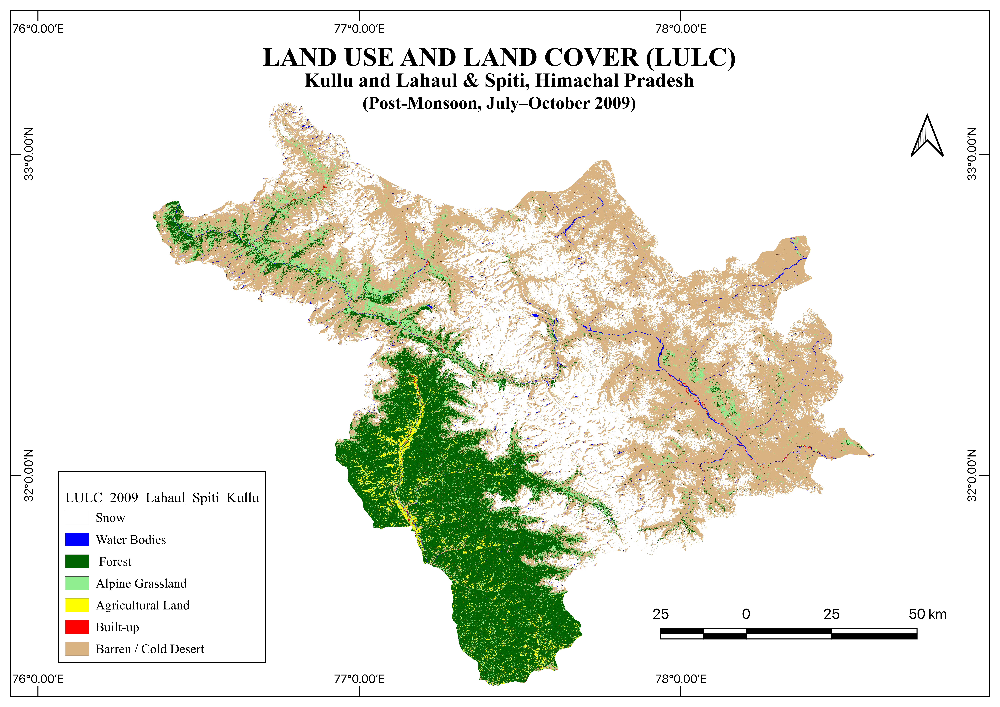

# High-Altitude LULC Classification of Kullu & Lahaul-Spiti, Himachal Pradesh

## Project Overview
An end-to-end supervised Land Use / Land Cover (LULC) classification workflow built in **Google Earth Engine (JavaScript API)** and **QGIS** covering **18,820.56 sq. km** of complex Himalayan terrain across **Kullu** and **Lahaul & Spiti** districts in Himachal Pradesh, India.

### Key Technical Highlights
* **Cloud-Free Seasonal Compositing:** Built a seamless late-summer / post-monsoon (July 15 – October 15) **Landsat 5 TM** mosaic using NASA's `simpleComposite` 25th-percentile cloud-scoring algorithm to eliminate scan-line gaps and seasonal cloud artifacts.
* **Supervised Machine Learning:** Trained a **150-tree Random Forest classifier** using **461 stratified reference samples** across 7 land cover classes (`Snow/Glacier`, `Water Bodies`, `Dense Forest`, `Alpine Grassland`, `Agricultural Land`, `Built-up`, and `Barren/Cold Desert`) alongside spectral indices (`NDVI`, `NDSI`, `NDWI`, `NDBI`).
* **Topographic & Hydrological Refinement:** Applied rule-based post-classification refinement using **SRTM DEM** derivatives (slope/elevation) and the **JRC Global Surface Water** dataset to eliminate mountain-shadow water misclassification and preserve sub-pixel Himalayan river continuity.
* **Cartographic Visualization:** Designed the final publication-ready map plate in **QGIS**.

---

## Class-Wise Area Distribution (2009)

| Class ID | LULC Class Name | Area (sq. km) | Percentage (%) |
| :---: | :--- | :---: | :---: |
| **0** | Snow / Glacier | 5,888.00 | 31.28% |
| **1** | Water Bodies | 138.18 | 0.73% |
| **2** | Dense Forest | 3,653.44 | 19.41% |
| **3** | Alpine Grassland | 747.31 | 3.97% |
| **4** | Agricultural Land | 351.97 | 1.87% |
| **5** | Built-up | 30.42 | 0.16% |
| **6** | Barren / Cold Desert | 8,011.24 | 42.57% |
| — | **Total Study Area** | **18,820.56** | **100.00%** |

---

## Accuracy Assessment
* **Overall Accuracy:** **89.33%** (134 / 150 independent validation samples)
* **Kappa Coefficient ($\kappa$):** **0.867**

---

## Tools & Datasets Used
* **Platforms:** Google Earth Engine (JavaScript API), QGIS
* **Satellite & Auxiliary Data:** Landsat 5 TM Collection 2, USGS SRTM 30m DEM, JRC Global Surface Water v1.4, FAO GAUL Administrative Boundaries
